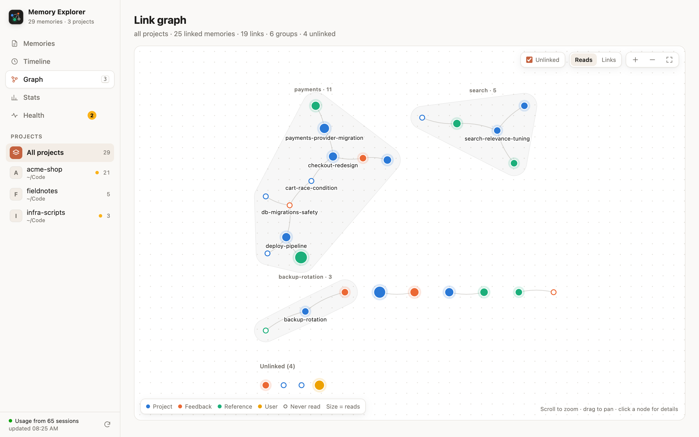
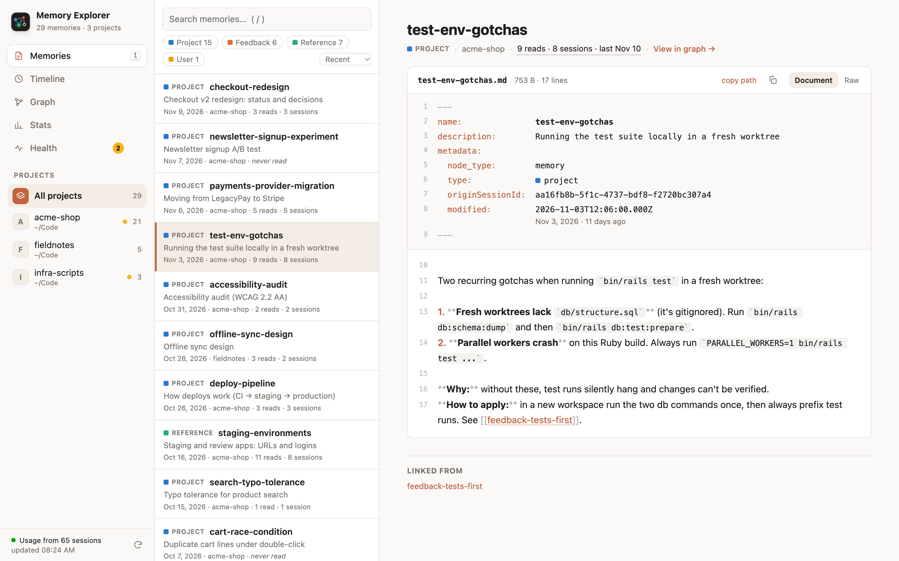
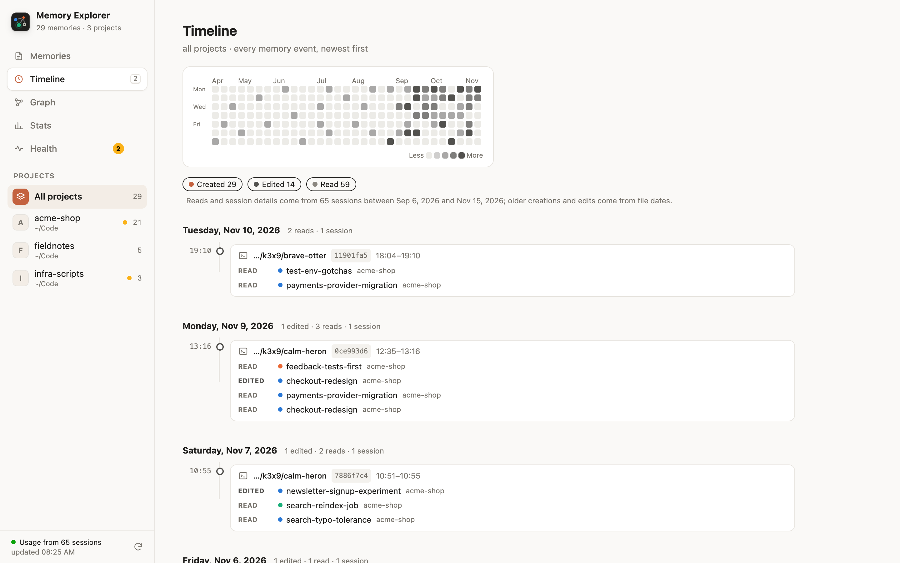
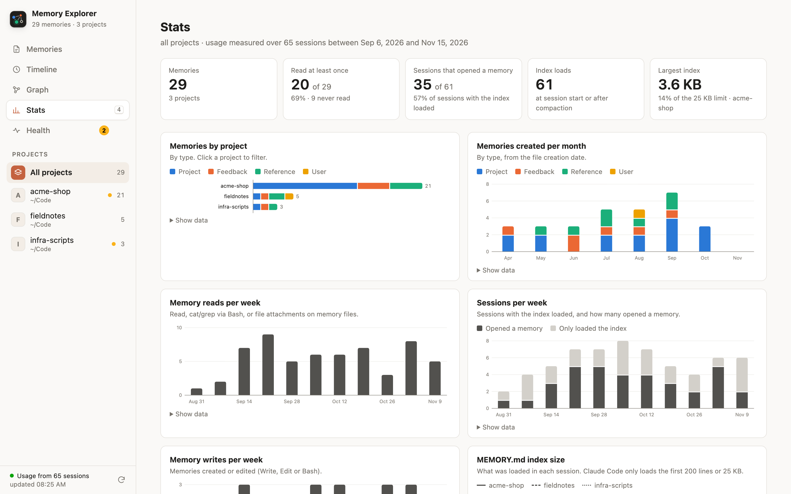
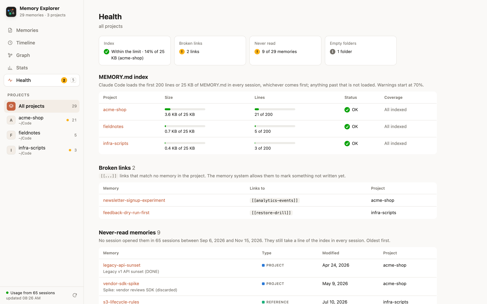

<p align="center"></p>

# Claude Memory Explorer

A local, read-only web UI to browse what Claude Code keeps in its memory (`~/.claude/projects/*/memory/`): the memories themselves, how often they are actually used, how they link to each other, and whether the memory index is healthy.



<table>
  <tr>
    <td width="50%"><br><sub><b>Memories</b> — the file line by line, plus how often it is read</sub></td>
    <td width="50%"><br><sub><b>Timeline</b> — every read and write, grouped by session</sub></td>
  </tr>
  <tr>
    <td width="50%"><br><sub><b>Stats</b> — inventory and weekly usage</sub></td>
    <td width="50%"><br><sub><b>Health</b> — index limit, broken links, never-read memories</sub></td>
  </tr>
</table>

<sub>Screenshots use the bundled demo data, not real memories.</sub>

## Getting started

### Requirements

- **Node.js 20 or newer** (`node -v` to check). Nothing else: no `npm install`, no dependencies.
- **Claude Code**, used at least once, so that `~/.claude/projects/` exists. Memories only show up once Claude has saved some; usage needs session transcripts.
- macOS or Linux. Windows is untested.

### Install and run

```sh
git clone https://github.com/furilo/claude-memory-explorer.git
cd claude-memory-explorer
node server.mjs
```

That's it: the server starts and your browser opens **http://localhost:4321**. Leave the terminal open while you use it, and press `Ctrl+C` to stop it.

The first time, the sidebar shows *Scanning transcripts…* for a few seconds while it reads your session history; memories are browsable right away, and usage numbers appear when the scan finishes. Later starts are almost instant thanks to the cache.

No memories of your own yet? Try it with made-up data:

```sh
node server.mjs --demo
```

### Options

| Option | What it does |
|---|---|
| `--port 5000` | Use another port (default `4321`) |
| `--no-open` | Don't open the browser automatically |
| `--demo` | Use generated demo data instead of `~/.claude` |
| `CLAUDE_CONFIG_DIR=/path node server.mjs` | Read another Claude config folder (also honoured if already set in your shell) |

### Update and uninstall

```sh
git pull                              # update, from the claude-memory-explorer folder
rm -rf claude-memory-explorer         # uninstall: delete the folder…
rm -rf ~/.cache/memory-explorer       # …and the usage cache
```

### Privacy

Everything runs on your machine. The server only listens on `127.0.0.1`, never modifies anything under `~/.claude`, and sends nothing anywhere. The only thing it writes is its usage cache in `~/.cache/memory-explorer/` (plus, with `--demo`, the sample data in a temporary folder).

### Troubleshooting

- **`Port 4321 is in use`** — another copy is probably running; open http://localhost:4321, or start this one with `--port 4322`.
- **No projects in the sidebar** — Claude hasn't saved any memory yet (only projects with memories are listed; empty memory folders appear under *Health*). Check `ls ~/.claude/projects/*/memory/`.
- **Usage numbers look low** — Claude Code deletes transcripts older than `cleanupPeriodDays` (30 days by default), so usage only covers recent sessions at first. The cache keeps what it has seen from then on; to keep more history in Claude Code itself, raise `cleanupPeriodDays` in `~/.claude/settings.json`.

## Views

Switch views from the sidebar or with the keys `1`–`5`. Every view can be filtered by project.

- **Memories** — search (`/`, `Esc`, `↑` `↓`), filter by type, and sort by date, reads, last read or name. Each memory is shown as the file itself: every line with its line number, the frontmatter as a highlighted block, and markdown markers kept visible but dimmed, so nothing is hidden. A **Raw** toggle shows the plain text. Above it, how many times the memory has been read, in how many sessions (and how many besides the one that created it), and when it was last read. `[[memory]]` links are clickable, with backlinks.
- **Timeline** — every memory event, newest first: a GitHub-style activity calendar on top (click a day to jump to it), then a day-by-day feed. Reads and writes found in transcripts are grouped by session (with the folder or worktree it ran in); creations and edits older than the transcripts come from file dates. Filter by created / edited / read.
- **Graph** — links between memories (`[[name]]` and markdown links to another memory). Colour is the memory type, size is reads (or links), and memories that were never read are hollow. Groups of tightly linked memories are drawn as soft hulls labelled with their topic. Hover a node to highlight its neighbours, click it for a detail card, double-click to open it. Scroll to zoom, drag to pan. Below the graph, the group list: large connected sets are split into communities (Louvain) — handy to decide what to review or merge. Click a group to zoom into it.
- **Stats** — memories by project, type and month; reads, writes and sessions per week; `MEMORY.md` index size against the 25 KB limit; most-read memories and which types get read.
- **Health** — index near or over the limit (Claude Code only loads the first 200 lines or 25 KB of `MEMORY.md`), memories missing from the index, broken links, never-read memories and empty memory folders (with how many sessions used them without saving anything).

## Demo data

`--demo` generates a fake `~/.claude` in a temporary folder (`demo.mjs`): three projects with 29 memories, links between them, an empty memory folder and ~65 sessions across the main repo and several worktrees, with dates relative to today. Its usage cache lives inside that temporary folder and is rebuilt on every run, so it never mixes with your real data.

## Where usage data comes from

`usage.mjs` reads the session transcripts (`~/.claude/projects/**/*.jsonl`) and extracts:

- **index loads**: the `AutoMem` attachment with `MEMORY.md`, at session start or after compaction;
- **reads**: `Read`, file attachments, or `cat`/`head`/`grep` via Bash on a memory file;
- **writes**: `Write`, `Edit`, or redirects/`sed -i` via Bash;
- **memory folder**: the folder each session was given in its system prompt, even when it stays empty.

Memory folders are per repository: sessions in git worktrees (Conductor, Paseo, `.claude/worktrees`…) share the memory of the main repo, while their transcripts live in a folder per worktree. The explorer reads all of them.

There is no way to tell whether Claude used an index line without opening the memory; only explicit reads count.

Results are cached in `~/.cache/memory-explorer/usage.json` (or `$XDG_CACHE_HOME`; any other `CLAUDE_CONFIG_DIR` gets a cache file of its own, seeded on first run with its entries from `usage.json`). The first scan takes a few seconds; after that only changed transcripts are re-read (around 100 ms). Claude Code deletes old transcripts (`cleanupPeriodDays`), but the cache keeps what it already analysed, so usage history keeps growing even after transcripts are gone. Delete that file to start over.

## Files

- `server.mjs` — HTTP server and memory loading
- `usage.mjs` — usage analysis with an incremental cache
- `index.html` — markup and styles
- `app.js` — UI logic
- `charts.js` — SVG charts
- `graph.js` — force layout, groups, hulls and pan/zoom for the graph
- `demo.mjs` — demo data generator (`--demo`)
- `logo.svg` — logo and favicon

## License

[MIT](LICENSE)
